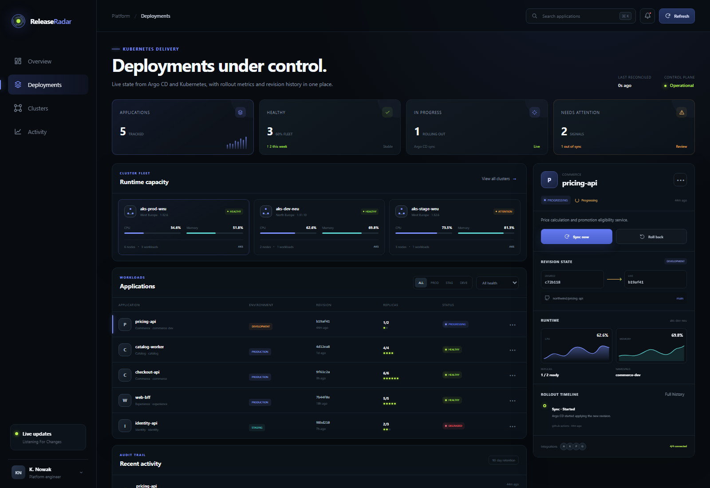
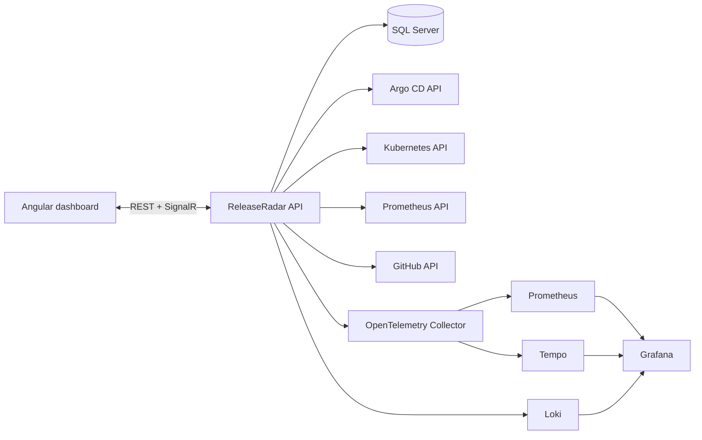

# ReleaseRadar

ReleaseRadar is a control panel for Kubernetes application deployments. It combines desired state from Argo CD with workload state from Kubernetes, runtime data from Prometheus and source revisions from GitHub.



The API can run against real integrations or use its built-in demo providers. Demo mode starts with five applications across three AKS clusters and does not require access to a Kubernetes environment.

## Functions

- application and cluster health overview;
- desired/live revision comparison and drift visibility;
- Argo CD sync and rollback actions;
- Kubernetes replica state;
- CPU and memory data read from Prometheus;
- GitHub revision resolution;
- deployment audit trail stored in SQL Server;
- live dashboard updates over SignalR;
- OpenTelemetry traces and metrics;
- Prometheus, Grafana, Tempo and Loki stack;
- Helm chart and Terraform configuration for Azure AKS.

## Stack

| Area | Technology |
| --- | --- |
| API | .NET 10, ASP.NET Core Minimal APIs, SignalR |
| Frontend | Angular 21, TypeScript, SCSS, RxJS |
| Data | EF Core 10, SQL Server |
| Delivery | Docker, Helm, Argo CD-compatible API |
| Azure | AKS, ACR, Azure SQL, Key Vault, Log Analytics, Terraform |
| Observability | OpenTelemetry, Prometheus, Grafana, Tempo, Loki, Serilog |
| Tests | xUnit, WebApplicationFactory, Vitest |

## Architecture



The domain layer owns deployment transitions and rollback rules. Infrastructure adapters handle persistence and external APIs. The ASP.NET Core project exposes endpoints, publishes SignalR events and runs periodic reconciliation. More detail is in [docs/architecture.md](docs/architecture.md).

## Run locally

Requirements: .NET 10 SDK, Node.js 22.22+ or 24.15+, and pnpm 11.

Start the API:

```powershell
dotnet run --project src/ReleaseRadar.Api
```

Start the frontend in a second terminal:

```powershell
cd frontend
pnpm install
pnpm start
```

Open `http://localhost:4200`. The API listens on `http://localhost:5080` and runs with in-memory demo data by default.

## Run the complete stack

```powershell
Copy-Item .env.example .env
docker compose up --build
```

| Service | Address |
| --- | --- |
| ReleaseRadar | `http://localhost:8080` |
| API | `http://localhost:5080` |
| Grafana | `http://localhost:3000` |
| Prometheus | `http://localhost:9090` |
| Tempo | `http://localhost:3200` |
| Loki | `http://localhost:3100` |

The compose stack uses SQL Server for deployment state and audit entries. Grafana is provisioned with Prometheus, Tempo and Loki data sources and the `ReleaseRadar operations` dashboard.

## Connect external systems

Each adapter switches independently between `demo` and `live` mode. Settings can be supplied through environment variables or `appsettings`:

```text
Integrations__ArgoCd__Enabled=true
Integrations__ArgoCd__BaseUrl=https://argocd.example.com
Integrations__ArgoCd__Token=...
Integrations__Kubernetes__Enabled=true
Integrations__Kubernetes__BaseUrl=https://kubernetes.default.svc
Integrations__Prometheus__Enabled=true
Integrations__Prometheus__BaseUrl=http://prometheus.monitoring.svc
Integrations__GitHub__Enabled=true
Integrations__GitHub__Token=...
```

Inside Kubernetes, the API reads the service-account token from the standard mounted path. The Helm chart creates read-only RBAC rules for workload discovery. Tokens and the SQL connection string are read from a Kubernetes Secret.

## API

| Method | Path | Description |
| --- | --- | --- |
| `GET` | `/api/overview` | Fleet summary, clusters and recent activity |
| `GET` | `/api/applications` | Filterable application list |
| `GET` | `/api/applications/{name}` | Application state and rollout timeline |
| `POST` | `/api/applications/{name}/sync` | Sync desired revision through Argo CD |
| `POST` | `/api/applications/{name}/rollback` | Restore the previous revision |
| `GET` | `/api/clusters` | Cluster capacity summary |
| `GET` | `/api/audit` | Deployment audit trail |
| `GET` | `/api/integrations/status` | Current adapter modes and endpoints |
| `GET` | `/health` | Health probe |
| `GET` | `/metrics` | Prometheus metrics |
| WebSocket | `/hubs/deployments` | Deployment state notifications |

## Tests

```powershell
dotnet test ReleaseRadar.sln
cd frontend
pnpm exec ng test --watch=false
pnpm run build
```

The CI workflow also validates Terraform, lints and renders the Helm chart, and builds both container images.

## Deployment

The Helm chart is located in `deploy/helm/release-radar`:

```powershell
helm upgrade --install release-radar deploy/helm/release-radar `
  --namespace release-radar --create-namespace `
  --set api.image.repository=<registry>/release-radar-api `
  --set web.image.repository=<registry>/release-radar-web
```

The Azure configuration in `deploy/terraform/azure` creates AKS, ACR, Azure SQL, Key Vault and Log Analytics. Copy `terraform.tfvars.example`, review the values, then run `terraform init`, `terraform plan` and `terraform apply`.
