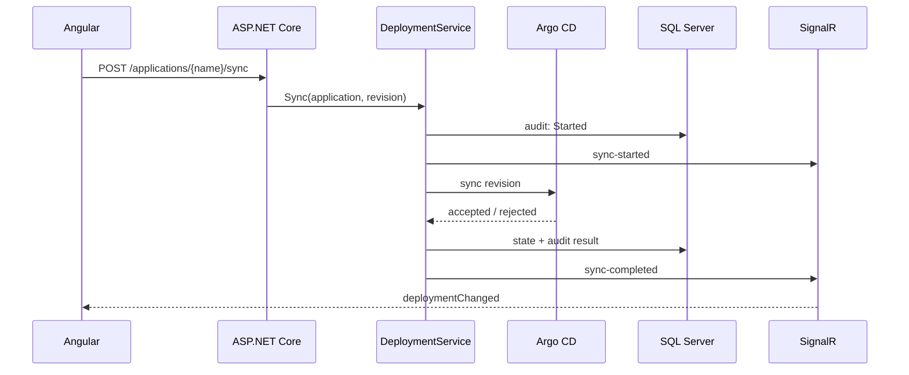

# Architecture

## Request and reconciliation paths

ReleaseRadar has two update paths:

1. REST commands handle user-initiated sync and rollback actions. The domain service records the requested transition, calls Argo CD, persists the result and publishes a SignalR event.
2. The reconciliation worker periodically reads Argo CD, Kubernetes and Prometheus in parallel. It updates health, sync status, replica counts and workload metrics in one database unit of work.

## Projects

- `ReleaseRadar.Contracts` contains HTTP DTOs.
- `ReleaseRadar.Domain` contains deployment state transitions, ports and the orchestration service.
- `ReleaseRadar.Infrastructure` contains EF Core persistence, seeding and external API adapters.
- `ReleaseRadar.Api` contains endpoint mapping, SignalR, telemetry and the reconciliation worker.
- `frontend` contains the Angular application.

## Integration modes

The live/demo switch is per adapter. This makes partial environments possible: for example, Argo CD and Kubernetes can be live while GitHub revision lookup remains disabled. `/api/integrations/status` exposes the active mode of every adapter.

The Argo CD adapter reads application health and sync state from `/api/v1/applications/{name}`. Sync and rollback both use Argo CD's sync endpoint; rollback supplies the recorded previous revision. The Kubernetes adapter reads Deployments using the current namespace and service account. Prometheus uses instant queries for CPU and memory utilization.

## Data

`DeploymentApplication` stores current desired/live/previous revisions and the latest runtime snapshot. `AuditRecord` is append-only application activity. SQL Server is used in container and Kubernetes deployments; the in-memory provider is limited to local demo mode and tests.

## Observability

ASP.NET Core and outgoing HTTP calls are instrumented with OpenTelemetry. OTLP data is sent to the collector, traces are stored in Tempo and metrics are exposed for Prometheus. Deployment commands also have explicit Prometheus counters. Serilog writes structured JSON to stdout and sends production logs to Loki.
